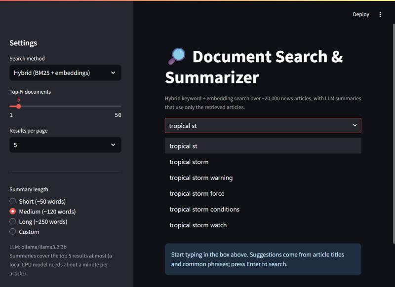
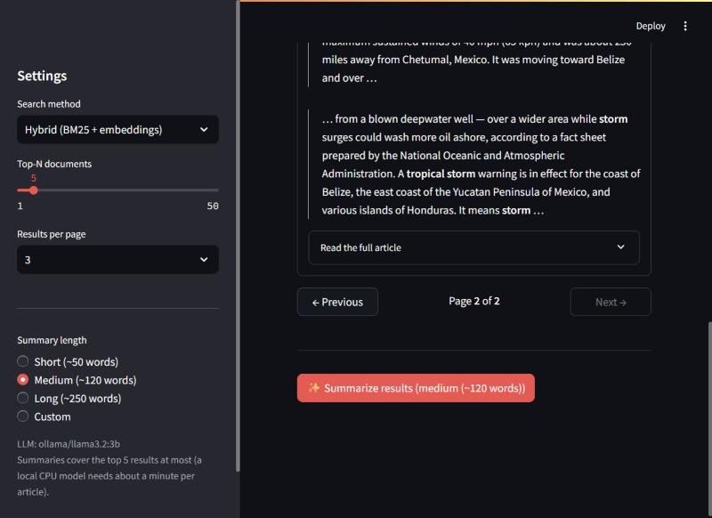
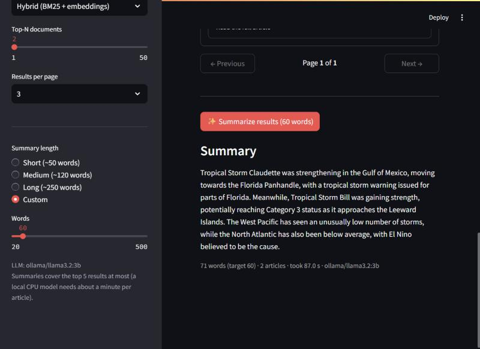

# Document Search and Summarization with LLMs

Search a news corpus with a **hybrid of BM25 and embeddings**, then get an **LLM summary of the top results at
the length you choose**. Runs on a CPU laptop; the LLM is either OpenAI (`gpt-4o-mini`) or a local Ollama model
(`llama3.2:3b`), selected in one config line. Data, indexes and models stay on your machine.

- **Search:** BM25, TF-IDF, dense (MiniLM + FAISS) and hybrid (Reciprocal Rank Fusion), document-level results with
  highlighted excerpts and pagination.
- **Summaries:** short (~50 words), medium (~120), long (~250) or any word count; map-reduce over several
  documents; cached on disk.
- **Evaluation:** search metrics, ROUGE vs lead-3, human-evaluation sheet, latency, optional embedding
  fine-tuning. Full write-up: [`reports/REPORT.md`](reports/REPORT.md) ([PDF](reports/REPORT.pdf)).
- **Interface:** Streamlit app with auto-suggestion, pagination and a summary-length control.


## Key results

200 generated test queries on a 20,000-article CNN/DailyMail corpus (77,338 chunks), local `llama3.2:3b`:

| Search method | Recall@1 | Recall@10 | MRR@10 | nDCG@10 |
|---|---|---|---|---|
| BM25 | 0.580 | 0.925 | 0.704 | 0.758 |
| TF-IDF | 0.495 | 0.875 | 0.635 | 0.695 |
| Dense | 0.540 | 0.905 | 0.676 | 0.733 |
| **Hybrid (RRF)** | **0.595** | **0.965** | **0.725** | **0.784** |

| Summaries (40 articles) | ROUGE-1 | ROUGE-2 | ROUGE-L | Words |
|---|---|---|---|---|
| Lead-3 baseline | 0.306 | 0.101 | 0.202 | 56.5 |
| LLM short (~50) | 0.371 | 0.132 | 0.252 | 49.3 |
| LLM medium (~120) | 0.297 | 0.107 | 0.190 | 123.5 |
| LLM long (~250) | 0.221 | 0.087 | 0.148 | 225.9 |

Speed on this CPU laptop: search 20-190 ms; one summary 36-52 s, a 3-article combined summary about 150 s with
the local model. Optional fine-tuned embeddings add about +0.03 MRR (small, within noise at n = 200). The
human-evaluation sheet (15 rows) is exported but **not yet scored**, so summary faithfulness is unmeasured.
See the report for details and limitations.

## Folder structure

```
config/config.yaml        all settings (paths, corpus size, chunking, top-N, models, provider, weights)
config/config.cloud.yaml  small-corpus settings for hosting
src/                      library: data_prep, indexing, search, llm, summarize, suggest, finetune, bootstrap
src/evaluation/           make_testset, eval_search, eval_summary, eval_latency
app/streamlit_app.py      web interface
scripts/                  prepare_data, build_index, query, run_eval, score_human_eval, finetune_embeddings, ...
tests/                    pytest unit tests (67)
reports/                  REPORT.md/.pdf, metrics CSV/JSON, figures/ (charts, architecture, UI screenshots)
data/  indexes/  models/  local only, git-ignored (large files)
```

## Setup (Windows / PowerShell; Python 3.11)

```powershell
py -3.11 -m venv .venv
.\.venv\Scripts\Activate.ps1
pip install -r requirements.txt
copy .env.example .env
```

Choose the LLM in `config/config.yaml` (`llm.provider`) or with `LLM_PROVIDER` in `.env`:

- **Ollama (free, offline, default):** install Ollama from <https://ollama.com>, then
  ```powershell
  ollama pull llama3.2:3b
  ollama serve        # skip if the Ollama app is already running
  ```
- **OpenAI:** put `OPENAI_API_KEY=sk-...` in `.env` and set `llm.provider: openai` (model `gpt-4o-mini`).
  The key is only ever read from the environment, never from code or config.

macOS/Linux: the same commands work with `source .venv/bin/activate` and `cp .env.example .env`.

## Step by step

```powershell
python scripts/prepare_data.py     # 1. stream 20,000 articles, clean, de-duplicate, chunk
python scripts/build_index.py      # 2. BM25 + TF-IDF + FAISS  (embedding ~40-80 min on CPU, resumable)
python scripts/query.py "tropical storm flooding" --top_n 5 --method hybrid --summarize --length medium   # 3.
python scripts/run_eval.py         # 4. evaluation (hours with a local LLM; resumable)
python scripts/score_human_eval.py # 5. after filling in reports/human_eval_sheet.csv (1-5 scores)
streamlit run app/streamlit_app.py # 6. web interface
```

What you should see:

1. `prepare_data.py` logs each cleaning step with document counts and prints corpus statistics
   (20,000 documents, 77,338 chunks); it also writes `reports/data_stats.json`.
2. `build_index.py` prints a table of build times and sizes (369 MB in total) and a sanity query; later runs reuse
   the saved indexes and load them in about 2 s.
3. `query.py` prints ranked documents with highlighted excerpts (`**word**`), for example:
   ```
   1. [0.0153] d16794  (hybrid)
      Tropical Storm Arlene appeared to be losing steam as it lumbered across Mexico Thursday...
      - **Tropical** **Storm** Arlene appeared to be losing steam ... torrential rains and **flooding** ...
   --- Summary (medium: target 120, actual 117 words; ollama/llama3.2:3b; 1 LLM calls; 24.77s) ---
   ```
   Options: `--method bm25|tfidf|dense|hybrid`, `--top_n`, `--page`, `--page_size`, `--length short|medium|long|<words>`.
4. `run_eval.py` prints the metric tables and writes `reports/metrics_summary.json` plus CSVs and
   `reports/figures/search_metrics.png`.
5. The Streamlit app opens at <http://localhost:8501>.

Optional: `python scripts/finetune_embeddings.py` fine-tunes the embedding model (see the report); afterwards set
`finetune.enabled: true` to use it. Quality checks: `python -m pytest`, `python -m ruff check .`,
`python -m black --check .`.

## The interface

| Auto-suggestion | Pagination (page 2 of 2) |
|---|---|
|  |  |



Sidebar: search method (hybrid by default), top-N, results per page, summary length (short / medium / long or a
custom 20-500 word slider). "Summarize results" summarizes the top results (at most 5) and shows the time taken.

## Hosting

### Local

```powershell
streamlit run app/streamlit_app.py
```

Needs the data and indexes from steps 1-2 (otherwise the app says so) and, for summaries, `ollama serve` running
or an OpenAI key.

### Streamlit Community Cloud (hosted demo)

The full corpus (data, indexes, models) is git-ignored and too large for a free host, so the hosted app builds a
**small demo corpus (2,000 articles, about 7,800 chunks) the first time it starts**, using
`config/config.cloud.yaml`. Ollama is not available on the host, so the hosted app uses OpenAI.

1. Push this repository to GitHub (never commit `.env`; it is git-ignored).
2. Go to <https://share.streamlit.io>, choose **New app**, connect the GitHub repository, branch `main`, main file
   `app/streamlit_app.py`. Under **Advanced settings** pick **Python 3.11**.
3. In **Advanced settings -> Secrets** paste:
   ```toml
   OPENAI_API_KEY = "sk-..."
   DOCSEARCH_CONFIG = "config/config.cloud.yaml"
   ```
4. Deploy. The first start downloads the dataset subset and the embedding model and builds the indexes
   (it took about 9 minutes and 54 MB on this laptop's CPU; a smaller free host may be slower); after that the app is ready. The host's disk is temporary, so a restarted app rebuilds once.

Notes and honest caveats: this was verified locally by running the same first-start build with
`DOCSEARCH_CONFIG=config/config.cloud.yaml` in separate folders (`data/cloud/`, `indexes/cloud/`), but it has
**not been deployed to Streamlit Community Cloud itself**, and the OpenAI summarization path has not been run with a
real key. The free tier has limited memory and CPU; if the build runs out of memory or time, lower
`corpus.train_docs` in `config/config.cloud.yaml`. To reuse the same bootstrap on any machine, set the
`DOCSEARCH_CONFIG` environment variable instead of the secret.

