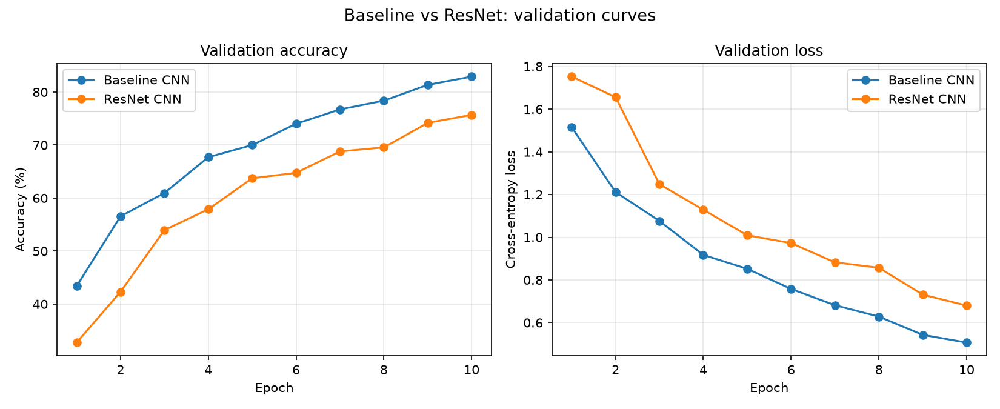
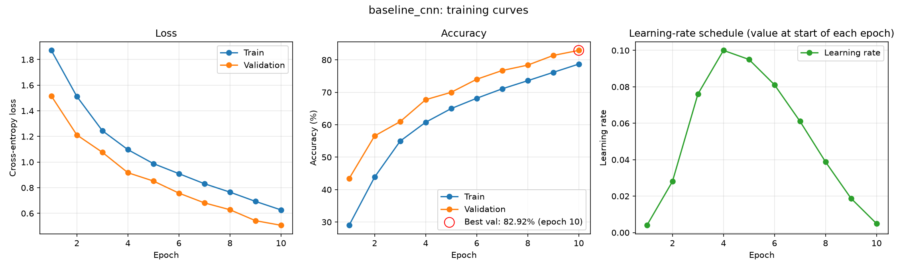
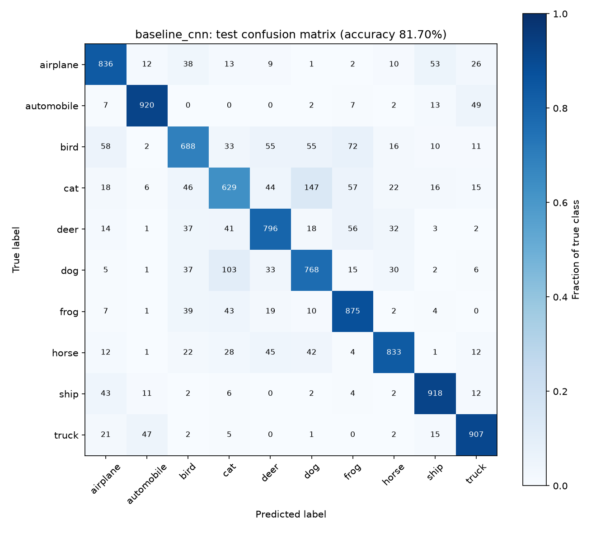
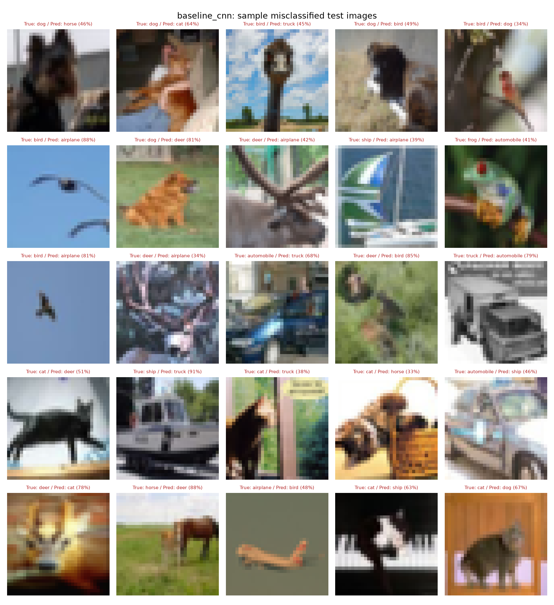

# CIFAR-10 Image Classification

A small convolutional network trained from scratch in PyTorch on CIFAR-10, plus a residual-block variant (Option A) compared against it. The project covers the full pipeline: data loading and augmentation, training with checkpointing, evaluation with plots, an ONNX export, a FastAPI service and a unit-test suite.

## Results at a glance

| Model | Parameters | Test accuracy | Test loss | Best validation accuracy | Training time (CPU) |
|---|---|---|---|---|---|
| **Baseline CNN** | 288,746 | **81.70%** | 0.5302 | 82.92% | 21.7 min |
| ResNet CNN (residual blocks) | 308,650 | 75.32% | 0.6979 | 75.70% | 81.2 min |

Both models were trained for 10 epochs with identical settings (seed 42, same data, optimiser and schedule) on the untouched 10,000-image test set.

**The residual variant did not improve on the baseline in this setup.** It scored 6.38 percentage points lower and took 3.7x longer to train. The gap is far larger than the roughly 0.4 pp standard error of a test accuracy at this level, and both models were still improving at epoch 10, so the comparison reflects a short 10-epoch budget rather than converged models. See [Results](#results) for the full comparison and caveats.

## Project structure

```
cifar10-classification/
├── configs/config.yaml     all hyperparameters, paths and options (single source of truth)
├── src/
│   ├── config.py           YAML -> validated Config dataclass, CLI overrides
│   ├── data.py             CIFAR-10 datasets, transforms, train/val split, DataLoaders, denormalize
│   ├── models.py           ConvBlock, BaselineCNN, ResidualBlock, ResNetCNN, build_model
│   ├── engine.py           train/evaluate loops, optimiser/scheduler factories, checkpoints, early stopping
│   ├── visualize.py        training curves, confusion matrix, misclassified grid, comparison plot
│   └── utils.py            seeding, device selection, logging, AverageMeter, Timer
├── train.py                training CLI (--resume, --quick, --amp)
├── evaluate.py             test-set evaluation, per-class metrics, plots
├── compare.py              baseline vs residual comparison report and plot
├── export_onnx.py          ONNX export and onnxruntime-vs-PyTorch check
├── app/main.py             FastAPI service (/health, /predict)
├── tests/                  pytest suite (models, data, utils/engine, API, reporting)
├── outputs/
│   ├── plots/              figures shown below
│   ├── results/            history and metrics JSON, comparison.md
│   ├── logs/               training and evaluation logs
│   ├── checkpoints/        model weights (git-ignored, regenerated by train.py)
│   └── model.onnx          exported baseline model used by the API
├── data/                   dataset download location (git-ignored)
├── requirements.txt        pinned dependencies
└── pytest.ini              test configuration
```

## Setup

Python 3.11+ is recommended (developed on 3.13).

```bash
python -m venv .venv
source .venv/bin/activate        # Windows: .venv\Scripts\activate
pip install -r requirements.txt
```

The CIFAR-10 archive (about 170 MB) downloads automatically into `data/` the first time any script needs it. On Windows, keep the project path short: a very long path can make `python -m venv` fail while installing pip.

## How to run

All commands run from the project root. Every value in `configs/config.yaml` can be overridden on the command line (for example `--epochs 5 --lr 0.05 --batch-size 64`).

```bash
python train.py --model baseline_cnn          # train the baseline
python train.py --model resnet_cnn            # train the residual network
python evaluate.py --model baseline_cnn       # test accuracy, per-class metrics, plots
python evaluate.py --model resnet_cnn
python compare.py                             # outputs/results/comparison.md + comparison plot
python export_onnx.py                         # outputs/model.onnx (add --model resnet_cnn for the ResNet)
uvicorn app.main:app --host 127.0.0.1 --port 8000
pytest -v                                     # run the unit tests
```

Other options:

```bash
python train.py --quick                       # 2-epoch smoke test on 2,048 images per split
python train.py --resume                      # continue from the run's last.pt (keep the same --epochs)
python train.py --amp                         # mixed precision (CUDA only)
```

Example request to the running API:

```bash
curl -X POST http://127.0.0.1:8000/predict -F "file=@cat.png"
```

`GET /health` reports the service status and `POST /predict` returns the top-3 classes with probabilities. Interactive docs are at `/docs`.

## Training setup

| Item | Value |
|---|---|
| Data split | 45,000 train / 5,000 validation (seeded random split of the 50,000 training images); the official 10,000 test images are used only for the final evaluation |
| Normalisation | per-channel mean (0.4913, 0.4822, 0.4466) and std (0.2470, 0.2436, 0.2617), computed on the 45,000-image training split (the commonly quoted full-train values are 0.4914, 0.4822, 0.4465 and 0.2470, 0.2435, 0.2616) |
| Augmentation (train only) | `RandomCrop(32, padding=4)` and `RandomHorizontalFlip`; validation and test get no augmentation |
| Batch size | 128 (train loader drops the last incomplete batch: 351 steps per epoch) |
| Optimiser | SGD, momentum 0.9, weight decay 5e-4 |
| LR schedule | `OneCycleLR`, peak 0.1, stepped every batch; per-epoch start values 0.004, 0.028, 0.076, 0.100, 0.095, 0.081, 0.061, 0.039, 0.019, 0.005 |
| Epochs | 10 |
| Regularisation | `Dropout2d(0.1)` after each block, `Dropout(0.3)` before the classifier |
| Other | gradient clipping off, mixed precision off, early stopping on validation accuracy (patience 5, never triggered) |
| Checkpointing | `last.pt` every epoch, `best.pt` when validation accuracy improves (best was the final epoch for both models) |
| Seed | 42 for Python, NumPy, PyTorch, the data split, the shuffle generator and DataLoader workers |
| Hardware | CPU only: Snapdragon X (X126100, 8 cores, ARM64), 15.6 GB RAM, Windows 11; PyTorch 2.14.1 (CPU build) |
| Training time | baseline 21.7 min (92-175 s per epoch); ResNet 81.2 min (324-550 s per epoch) |

The device is detected automatically in the order CUDA, Apple MPS, CPU. Hyperparameters were set once, up front, and not tuned: there was no learning-rate or architecture search, and the test set was used a single time per model after the best checkpoint had been chosen on validation accuracy.

## Model design decisions

**Baseline CNN (288,746 parameters).** Three convolutional blocks with 32, 64 and 128 channels, each `Conv3x3 -> BatchNorm -> ReLU -> Conv3x3 -> BatchNorm -> ReLU -> MaxPool(2) -> Dropout2d(0.1)`, followed by global average pooling, `Dropout(0.3)` and a linear layer producing 10 logits.

- **Depth and width.** Two 3x3 convolutions per block, repeated at three resolutions (32x32, 16x16, 8x8), is a standard small VGG-style layout that gives a receptive field large enough for 32x32 images. The narrow widths (32-64-128) were chosen because training runs on a CPU within a limited time budget; a 64-128-256 version would have roughly four times the parameters and compute. These choices were not ablated.
- **BatchNorm.** Placed after every convolution, so the convolutions have `bias=False`. It stabilises training and makes the high peak learning rate (0.1) usable.
- **Dropout placement.** Light spatial dropout (0.1) drops whole feature maps after each block, which suits correlated convolutional features. Stronger standard dropout (0.3) sits just before the classifier, where the representation is a small dense vector.
- **Global average pooling.** Replaces a large flatten-plus-dense layer: the head has only 128 x 10 + 10 parameters, which limits overfitting and keeps the model size small.
- **Kaiming initialisation.** Convolution weights use Kaiming normal initialisation (fan-out, ReLU gain), matched to the ReLU activations. The initial weight spread was checked against the expected value during development.

**Residual variant (308,650 parameters).** A conv stem (`Conv3x3 -> BatchNorm -> ReLU`, 32 channels), then three `ResidualBlock` stages with 32, 64 and 128 channels, global average pooling, `Dropout(0.3)` and a linear layer.

- **Residual block.** `Conv3x3 -> BN -> ReLU -> Conv3x3 -> BN`, added to a shortcut and followed by a ReLU. The skip connection gives gradients a direct path and lets a block learn a correction to its input.
- **Projection shortcut.** When the stride or channel count changes, the shortcut is a 1x1 convolution plus BatchNorm so that the two branches can be added. Otherwise it is the identity.
- **Comparable size.** The widths match the baseline so that the comparison is about the architecture, not capacity (about 7% more parameters). Dropout is kept in the same places.
- **Downsampling difference.** The residual network downsamples with stride-2 convolutions where the baseline uses max-pooling. This is a second difference between the models, so the measured gap cannot be attributed to the skip connections alone.

## Results

### Baseline vs residual network

| Metric | Baseline CNN | ResNet CNN | Difference |
|---|---|---|---|
| Parameters | 288,746 | 308,650 | +19,904 |
| Epochs trained | 10 | 10 | - |
| Training time (min) | 21.7 | 81.2 | +59.5 |
| Best validation accuracy | 82.92% (epoch 10) | 75.70% (epoch 10) | -7.22 pp |
| Final train accuracy | 78.70% | 71.20% | -7.50 pp |
| **Test accuracy** | **81.70%** | **75.32%** | **-6.38 pp** |
| Test loss | 0.5302 | 0.6979 | +0.1677 |
| Macro F1 (test) | 0.8156 | 0.7518 | -0.0638 |

Per-class test accuracy:

| Class | Baseline CNN | ResNet CNN | Difference |
|---|---|---|---|
| airplane | 83.6% | 75.6% | -8.0 pp |
| automobile | 92.0% | 88.8% | -3.2 pp |
| bird | 68.8% | 58.5% | -10.3 pp |
| cat | 62.9% | 57.0% | -5.9 pp |
| deer | 79.6% | 69.0% | -10.6 pp |
| dog | 76.8% | 66.1% | -10.7 pp |
| frog | 87.5% | 83.3% | -4.2 pp |
| horse | 83.3% | 75.2% | -8.1 pp |
| ship | 91.8% | 91.4% | -0.4 pp |
| truck | 90.7% | 88.3% | -2.4 pp |



The ResNet is behind at every epoch: after epoch 5 its validation accuracy was 63.74% against 70.00% for the baseline. Neither model overfits. Validation accuracy sits above training accuracy throughout (training metrics are measured with dropout and augmentation active, averaged over the epoch while the weights are still improving), and both losses are still falling at epoch 10. Both models are therefore under-trained at this budget. Other caveats: each model was trained once, so there is no seed-to-seed variance estimate, and no explanation of the residual network's deficit was tested. Candidates would be a longer schedule, max-pooling instead of strided convolutions, or a deeper and wider residual network. The generated report is in [outputs/results/comparison.md](outputs/results/comparison.md).

### Baseline CNN

Training curves (loss, accuracy and learning-rate schedule; the best validation epoch is circled):



Confusion matrix on the test set (colour is the fraction of each true class, numbers are counts):



Random sample of misclassified test images, with true label, predicted label and confidence:



The ResNet's equivalent plots are [curves](outputs/plots/resnet_cnn_curves.png), [confusion matrix](outputs/plots/resnet_cnn_confusion_matrix.png) and [misclassified samples](outputs/plots/resnet_cnn_misclassified.png). A grid of augmented training images is in [outputs/plots/sample_batch.png](outputs/plots/sample_batch.png).

### Analysis of misclassifications

The baseline makes 1,830 errors on the 10,000 test images. The most frequent confusions (true class to predicted class) are:

| Baseline | Count | ResNet | Count |
|---|---|---|---|
| cat to dog | 147 | dog to cat | 179 |
| dog to cat | 103 | cat to dog | 171 |
| bird to frog | 72 | bird to deer | 103 |
| bird to airplane | 58 | bird to frog | 94 |
| cat to frog | 57 | airplane to ship | 90 |
| deer to frog | 56 | deer to frog | 83 |

- **Cats and dogs** are the weakest pair for both models (cat is the worst class at 62.9% for the baseline and 57.0% for the ResNet; dog is third worst for the baseline). They are the most confusable pair, with 250 baseline errors between them. They share body shape, fur texture and often indoor backgrounds, and at 32x32 pixels the facial details that distinguish them are only a few pixels wide.
- **Birds** (68.8%) are confused with frogs, airplanes and deer. In the sampled error grid, two small birds against a plain sky were labelled airplane with 81% and 88% confidence. Birds vary widely in pose and size and often fill only a small part of the frame, so the model falls back on background cues.
- **Animals against green or brown backgrounds** (deer, frog, bird) are mixed up with each other, consistent with the model relying partly on colour and context.
- **Vehicles** are the easiest classes (automobile 92.0%, ship 91.8%, truck 90.7%). Their remaining errors are between visually related classes: automobile and truck (49 and 47 errors), airplane and ship (53 and 43), which often share sky or water backgrounds.

These explanations are readings of the confusion matrix and the sampled images, not tested hypotheses.

## Reproducibility

- Seeds are set before the data and the model are built: `set_seed` covers `random`, NumPy and PyTorch (CPU and all CUDA devices) and sets `cudnn.deterministic=True` and `cudnn.benchmark=False`. The train/validation split, the shuffle order (a seeded `torch.Generator`) and the DataLoader workers (`worker_init_fn`) are seeded too.
- Two separate `--quick` runs on this CPU produced identical epoch losses and accuracies.
- Dependencies are pinned in `requirements.txt`; the device and package versions are recorded above.
- Remaining sources of non-determinism: multi-threaded floating-point reductions on CPU can differ slightly between machines; on CUDA some kernels are non-deterministic even with the flags above; resuming from a checkpoint restores the model, optimiser and schedule but not the random generator state; wall-clock training times vary with machine load.
- The full 10-epoch runs were not repeated, so run-to-run variation of the final accuracies has not been measured.

## Optional extensions

Done:

- **Mixed precision** (`--amp`): `torch.autocast` with `GradScaler`, active on CUDA only. On CPU or MPS it logs a warning and trains in full precision. The CUDA path could not be run on the CPU-only development machine; the scaler logic was exercised on CPU in a unit test.
- **ONNX export** (`export_onnx.py`): single-file model with a dynamic batch axis. Against PyTorch on 100 test images the maximum absolute logit difference is 5.7e-06 and predictions agree on 100% of them.
- **FastAPI service** (`app/main.py`): `GET /health`, `POST /predict` (resizes to 32x32, applies the training normalisation, returns the top-3 classes). The ONNX model is loaded once at startup. It was checked with `TestClient` and a running `uvicorn` server using real test images: on 50 test images its top-1 prediction matched PyTorch on all 50 and was correct on 46.
- **Unit tests** (`pytest -v`, 57 tests, about 10 s): models, data pipeline, seeding, checkpoints, training step, API and reporting. They use dummy data and do not download the dataset.

Out of scope: distributed training (DDP) and TPU support, which are not relevant to a single-device setup, plus hyperparameter search and multi-seed repeats.
