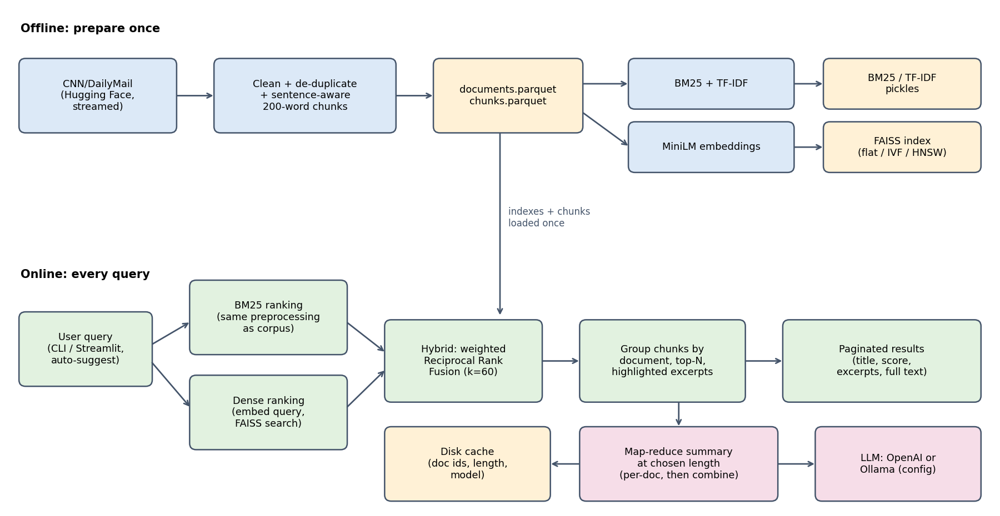

# Project Learning Guide: Document Search and Summarization Using LLMs

**Purpose of this guide.** Read this before your evaluation. It explains the whole project in plain language:
what the system does, the ideas behind it, every phase we built, **why** each step was needed, **every
error we hit and how it was fixed**, all the numbers, and the questions an examiner is likely to ask.
Everything here is taken from what was actually done in this repository (no invented results).

---

## Part 0. The project in two minutes (say this first in the evaluation)

**Problem.** A news archive is too big to read. People need to (1) *find* the few relevant articles and (2) get a
*short summary* of them.

**What we built.**

1. A **search engine** over 20,000 CNN/DailyMail news articles that combines two kinds of search:
   - **keyword search** (BM25 / TF-IDF): matches the exact words you type;
   - **meaning search** (embeddings + FAISS): matches the *meaning*, even with different words;
   - **hybrid**: the two ranked lists are merged with **Reciprocal Rank Fusion (RRF)**.
2. A **summarizer** that sends the retrieved articles to an LLM (local Ollama `llama3.2:3b` or OpenAI
   `gpt-4o-mini`) and produces a summary of the length the user picks (about 50, 120 or 250 words, or any number).
   For several documents it uses **map-reduce** (summarize each, then combine) and **caches** results.
3. A **web app** (Streamlit) with auto-suggestion, pagination and a summary-length control.
4. An **evaluation**: 200 auto-generated test queries, search metrics, ROUGE for summaries, latency, and an
   optional embedding fine-tuning experiment.

**Headline results (all real, from our runs).**

| Search method | Recall@1 | Recall@10 | MRR@10 | nDCG@10 |
|---|---|---|---|---|
| BM25 | 0.580 | 0.925 | 0.704 | 0.758 |
| TF-IDF | 0.495 | 0.875 | 0.635 | 0.695 |
| Dense (embeddings) | 0.540 | 0.905 | 0.676 | 0.733 |
| **Hybrid (RRF)** | **0.595** | **0.965** | **0.725** | **0.784** |

Hybrid is best on every metric. For summaries, the 50-word LLM summary scored ROUGE-1 **0.371** versus
**0.306** for the lead-3 baseline on the same 40 articles.

**Honest gaps (say them before the examiner finds them).** The human-evaluation ratings are not filled in
(the sheet has 15 rows, not 30); ROUGE was run on 40 documents, not all 200 (CPU speed); the OpenAI path and
the cloud deployment were never run for real.



---

## Part 1. Concepts you must understand

### 1.1 The data pipeline words

- **Corpus**: the collection of documents we search (20,000 articles).
- **Cleaning**: removing junk that is not content (datelines, URLs, duplicates) so it does not distort search.
- **Tokenization**: splitting text into words (tokens). We lowercase and split on non-letters/digits.
- **Stopwords**: very common words ("the", "of", "and") that carry little meaning; removed for keyword search.
- **Chunking**: cutting each article into pieces of about 200 words (with about 40 words overlap), at sentence
  boundaries. **Why:** embedding models have a length limit (we use 256 tokens), a chunk gives a *focused*
  excerpt to show the user, and a long article may be about several things.
- **Document-level result**: users want articles, not fragments, so chunk hits are grouped by article and the
  article's score is its best chunk's score.

### 1.2 Keyword search: TF-IDF and BM25

- **TF (term frequency)**: how often a word appears in a document. **IDF (inverse document frequency)**: how rare
  the word is across all documents (rare words are more informative).
- **TF-IDF** = TF x IDF, then documents are compared with the query by cosine similarity. We used
  `sublinear_tf` (log of the count) so a word repeated 50 times does not dominate.
- **BM25** is a better version of the same idea. Score of a document D for query words q_i:

  `score = sum over q_i of IDF(q_i) * ( f * (k1 + 1) ) / ( f + k1 * (1 - b + b * |D| / avgdl) )`

  where f = how often q_i is in D, |D| = document length, avgdl = average length. **k1 (1.5)** controls how fast
  repeated words stop mattering (term-frequency saturation), **b (0.75)** controls length normalisation (long
  documents should not win just because they are long).
- **Weakness of both:** they only match *words*. "car" will not match "automobile".

### 1.3 Meaning search: embeddings and FAISS

- An **embedding** is a list of numbers (a vector, here 384 numbers) that represents the *meaning* of a text.
  Texts with similar meanings have vectors that point in similar directions.
- We use the sentence-transformers model **all-MiniLM-L6-v2** (small, fast on CPU, 384 dimensions).
- We **L2-normalise** vectors (length 1). Then the **inner product equals cosine similarity**, which is why we use
  FAISS `IndexFlatIP` (IP = inner product).
- **FAISS** is a library for fast nearest-neighbour search over vectors. **Flat** = exact (compares with every
  vector); **IVF** = cluster the vectors and search only some clusters; **HNSW** = a graph index. IVF/HNSW are
  approximate but much faster on millions of vectors (our scalability path).
- **Weakness:** can miss exact names/numbers that keyword search catches.

### 1.4 Hybrid search and Reciprocal Rank Fusion (RRF)

BM25 scores (unbounded, e.g. 23.3) and cosine scores (0 to 1) are on different scales, so you cannot just add
them. **RRF uses only ranks:**

`RRF score(chunk) = w_bm25 / (60 + rank_in_BM25) + w_dense / (60 + rank_in_dense)`

(we use weights 0.5 and 0.5, and the constant **k = 60**, the standard value; it softens the gap between rank 1
and rank 2.) **Worked example:** a chunk ranked 1st by BM25 and 3rd by dense gets
0.5/61 + 0.5/63 = 0.00820 + 0.00794 = 0.01614. A chunk ranked 1st by only one ranker (absent from the other) gets
0.5/61 = 0.0082. So chunks found by *both* rankers rise to the top. That is why hybrid beats each alone.

### 1.5 LLM concepts used

- **Prompt**: the instruction text we send. Ours says: use only the given text, add no outside facts, write one
  plain paragraph, aim for N words.
- **Temperature (0.2)**: low = more consistent, less creative output (good for summaries).
- **Context window**: the maximum text the model can read at once (we request 4,096 tokens from Ollama).
- **Map-reduce summarization**: *map* = summarize each document separately (about 100 words each); *reduce* =
  combine those summaries into one summary of the requested length. **Why:** many full articles do not fit in
  the context window, and it is cheaper; per-document summaries can be cached and reused.
- **Hallucination**: the model inventing facts. We reduce it with the "use only the text" instruction, but we
  did **not** measure it (needs human or automatic faithfulness checking).
- **Provider abstraction**: one `LLMClient` interface with `OpenAIClient` and `OllamaClient`; switch with a
  config line. This is why the project is "pluggable".

### 1.6 Evaluation metrics

For each test query exactly **one** document is relevant (the article the query was written from).

- **Recall@k (= hit rate)**: fraction of queries where the target is in the top k. Recall@10 = 0.965 means the
  right article was in the top 10 for 96.5% of queries.
- **MRR@10 (mean reciprocal rank)**: average of 1/rank of the target (rank 1 gives 1, rank 2 gives 0.5, not in
  top 10 gives 0). Rewards putting the target *high*.
- **nDCG@10**: like MRR but with a smoother discount, 1/log2(rank+1).
- **Precision@5**: hits in the top 5 divided by 5; with one relevant document it can never exceed 0.2, which is
  why our values are about 0.17.
- **ROUGE-1 / ROUGE-2 / ROUGE-L**: overlap of words / word pairs / longest common subsequence between our summary
  and the human-written "highlights". We report the **F1** (balance of precision and recall) with stemming.
- **Lead-3 baseline**: just the first three sentences of the article. A famous strong baseline for news; our
  summaries should beat it.
- **Latency**: time taken; we report the mean and the **p95** (95% of requests are faster than this).

### 1.7 Fine-tuning (Phase 7)

- **Domain adaptation**: nudging the general embedding model so it understands *this* kind of data/queries better.
- **MultipleNegativesRankingLoss (MNRL)**: training data = pairs (query, correct passage). Inside a batch of 32
  pairs, each query's correct passage is the positive and the other 31 passages are **negatives**. The model
  learns to pull the pair together and push the others away. No negative examples need to be labelled.
- We used 300 pairs, 1 epoch (9 training steps), learning rate 2e-5.

---

## Part 2. The tools and why we chose them

| Tool | Used for | Why this one |
|---|---|---|
| Python 3.11 (x64) + venv | everything | Brief asked for 3.10+; 3.11 has wheels for all ML libraries; venv keeps versions isolated |
| `datasets` (Hugging Face) | download CNN/DailyMail | Streams the data so only the needed part is downloaded (saves disk) |
| pandas + parquet | store documents/chunks | Fast, compact columnar files |
| `rank_bm25`, scikit-learn | BM25, TF-IDF | Simple, explainable, standard |
| sentence-transformers (MiniLM) | embeddings | Small (384-d), good quality, runs on CPU |
| FAISS (`faiss-cpu`) | vector search | Industry standard; has flat/IVF/HNSW for scaling |
| Ollama + `llama3.2:3b` | local LLM | Free, offline, runs on CPU (brief requirement) |
| OpenAI `gpt-4o-mini` | optional LLM | Fast, higher quality; key from `.env` only |
| Streamlit + streamlit-searchbox | web app | Quick Python UI; searchbox gives as-you-type suggestions |
| `rouge-score` | ROUGE | Standard implementation, supports stemming |
| pytest, ruff, black | quality | Tests, lint, formatting |
| matplotlib | charts and the architecture diagram | Reproducible figures |
| Edge/Chrome headless | export the PDF | No other PDF tool was installed |
| git | version control | One commit per phase |

**Where everything lives:** `C:\DocSearchLLM\doc-search-summarizer` (a separate project from the earlier CatalogIQ
project that was in a different folder).

---

## Part 3. File map: what each file does

| File | Purpose |
|---|---|
| `config/config.yaml` | **All settings** in one place (paths, corpus size, chunk size, top-N, models, weights, provider...). No magic numbers in code |
| `config/config.cloud.yaml` | Small-corpus settings for hosting (extends the main config) |
| `.env` / `.env.example` | Secrets (`OPENAI_API_KEY`); `.env` is git-ignored, the example is committed |
| `src/config.py` | Loads YAML + `.env`; `extends:` support; `finetuned` variant switch |
| `src/utils.py` | Logger, `@timed` decorator, `DiskCache` |
| `src/data_prep.py` | Stream, clean, de-duplicate, chunk, save |
| `src/indexing.py` | Build/load BM25, TF-IDF, embeddings, FAISS |
| `src/search.py` | BM25 / TF-IDF / dense / hybrid search, RRF, excerpts, pagination |
| `src/llm.py` | OpenAI and Ollama clients, retries, timeouts, clear errors |
| `src/summarize.py` | Length-controlled single/multi-document summaries, map-reduce, cache |
| `src/suggest.py` | Auto-suggestion prefix index |
| `src/ui_helpers.py` | Markdown escaping and pagination maths for the app |
| `src/finetune.py` | Fine-tuning pairs, training, re-indexing, comparison |
| `src/bootstrap.py` | First-start build of a small corpus for hosted demos |
| `src/evaluation/*.py` | Test set, search metrics, ROUGE and human sheet, latency |
| `scripts/*.py` | Command-line entry points (prepare_data, build_index, query, run_eval, ...) |
| `app/streamlit_app.py` | The web interface |
| `tests/*.py` | 67 unit tests |
| `reports/` | REPORT.md/.pdf, all result CSV/JSON files, figures, this guide |

---

## Part 4. Phase-by-phase walkthrough (what, why, errors, fixes)

### Phase 0. Project scaffold

**What we did.** Created the folder structure from the brief; wrote `config/config.yaml`, `src/config.py`,
`src/utils.py`, stub modules with type hints and docstrings, a first test file, `.gitignore`, `.env.example`,
`requirements.txt` (all versions pinned), README; initialised git; created a Python 3.11 virtual environment;
installed all requirements; confirmed the config loads; committed.

**Why it was needed.** A clean, config-driven structure means later phases only fill in code; nothing is
hard-coded; the `.gitignore` guarantees secrets and big files never reach GitHub.

**Decisions.** The default Python (3.13) on this machine is an ARM build; we used the Python 3.11 x64 build for
broad package support. Only `src/config.py` and `src/utils.py` were real code; everything else was stubs.

**Errors and fixes.**

| Error | Cause | Fix |
|---|---|---|
| `git commit` failed: "Author identity unknown" | git had no user name/email | Set `user.name`/`user.email` for this repository only (not global) |
| Installing requirements exceeded the 10-minute command limit | `torch` and others are very large | Moved the install to the background and waited for completion |
| Confusion about project location | The folder we started in held an older project (CatalogIQ) | You asked for a separate folder on C:; we created `C:\DocSearchLLM` and kept the projects apart |

**Result.** 3 tests pass; config loads (provider `ollama`, top_n, paths).

### Phase 1. Data preparation

**What we did.** Streamed `abisee/cnn_dailymail` (3.0.0). Took the first 20,000 train articles that survive
cleaning as the corpus, and 1,000 test-split articles as a separate held-out pool. Cleaned (see table), removed
duplicates, split into sentence-aware chunks, saved `documents.parquet`, `chunks.parquet`, `heldout.parquet`, and
`reports/data_stats.json`.

**Why the corpus.** Big real news corpus, and every article has human **highlights** (reference summaries) that we
need for ROUGE. Streaming avoids downloading the whole dataset.

**Cleaning steps and why** (counts are documents affected, from `data_stats.json`):

| Step | Count | Why |
|---|---|---|
| Remove datelines `LONDON, England (CNN) --`, `(Mashable) --`, `(Reuters) --` | 21,035 | In almost every article, carry no meaning; they would make every article match "CNN" |
| Remove "E-mail to a friend" | 1,273 | Web navigation text |
| Remove URLs / HTML tags / HTML entities | 273 / 1 / 16 | Not content |
| Unicode NFKC + whitespace | 225 / 6,405 | Same character = same token |
| Drop articles under 50 words | 8 | Too short to be useful |
| Drop exact duplicates | 1,360 | Would flood top-N with the same story |
| Drop near-duplicates (same first 40 words) | 122 | Re-published versions |

21,490 rows were read to keep 20,000. Words: 12,843,994 before cleaning, 11,864,717 after. Final: **20,000
documents, 77,338 chunks** (3.87 per article, 192 words on average).

**Errors and fixes.**

| Error | Cause | Fix |
|---|---|---|
| After the first run, 442 articles still had "(CNN)" and 1,075 started with outlet datelines like "(Mashable) --" | My first pattern only handled "LONDON (CNN) --" at the very start | Inspected the output with a script, then added patterns for partner outlets |
| Still 2,279 articles with "(CNN" mid-text such as "...before trial. NEW YORK (CNN) -- ..." | Datelines can follow a caption sentence; locations can be several words ("NEW YORK") or hyphenated | Added a mid-text pattern (after a sentence end), multi-word and hyphenated locations, and an inline fallback |
| A new test failed: the dateline pattern swallowed the word "Teaser." in front | A period was allowed inside the location word | Disallowed periods in the first word of the location |
| Wire datelines like "LONDON, England (Reuters) --" stayed in titles | Pattern did not allow a location before the outlet | Allowed an optional location; excluded political tags like "(D-Mass.)" so real text is not removed |
| `NativeCommandError` and a red error in PowerShell while the script actually worked | PowerShell treats the warning text written to stderr (Hugging Face symlink warning) as an error | Redirected output through `cmd /c "... > log 2>&1"`; the warning itself is harmless on Windows |

**Lesson to say in the evaluation.** "I did not trust the first cleaning pass. I measured what was left, found
patterns I had missed, fixed them, and added unit tests so they cannot regress. The Daily Mail patterns match
nothing in this slice because the first 20,000 train articles are almost all from CNN."

### Phase 2. Indexing

**What we did.** Built (1) a **BM25** index (`rank_bm25`, k1=1.5, b=0.75), (2) a **TF-IDF** index (scikit-learn),
(3) **embeddings** of all 77,338 chunks with MiniLM, L2-normalised, (4) a **FAISS flat** inner-product index.
All saved in `indexes/`; later runs *load* them. Added a config switch for FAISS `ivf`/`hnsw`.

**Why.** Searching 77k chunks by scanning text would be slow; an index precomputes what we need. Persisting avoids
rebuilding (embedding takes more than an hour).

**Numbers.** BM25 15 s / 76.5 MB; TF-IDF 12 s / 55.3 MB; embeddings **77.7 min** / 118.8 MB; FAISS 0.2 s /
118.8 MB; total 369.4 MB; loading all indexes takes 1.9 s.

**Errors and fixes.**

| Problem | Cause | Fix |
|---|---|---|
| Embedding took 78 minutes (expected 40) and the laptop could sleep | CPU-only and the Python is an emulated x64 build; the machine was busy | Embedding runs in blocks of 5,000 and saves each block, so an interruption **resumes**; asked the app to keep the computer awake |
| A Hugging Face network timeout appeared during the sanity query (retried automatically) | The model was re-checked online each time | Later made the loader try `local_files_only=True` first, then fall back to the network |

**Say this:** "Embedding is the only expensive step and it's a one-off; the index is persisted and loaded in under
two seconds."

### Phase 3. Document search

**What we did.** `src/search.py` with `search(query, top_n, method, page, page_size)`:

- Query preprocessing identical to the corpus (lowercase, tokenize, drop stopwords) for BM25/TF-IDF; raw query
  embedded for dense.
- **Hybrid** = weighted RRF (k = 60).
- Chunk hits aggregated to documents (best chunk's score), top-N, pagination.
- **Excerpts:** the 60-word window with the most query words, with matches highlighted as `**word**`.
- CLI: `python scripts/query.py "query" --top_n 5 --method hybrid`.

**Why.** The core requirement: top-N documents/excerpts using a hybrid of traditional IR and LLM embeddings.
Using the same preprocessing for query and corpus is essential, otherwise the words would not match.

**Observed behaviour (3 queries x 4 methods, `reports/sample_queries.txt`).** Keyword-style queries: all methods
agree. Paraphrase-style query ("tropical storm causes flooding and evacuations"): dense finds flood stories from
Vietnam and the Philippines that BM25 misses, BM25 finds a Florida storm article; hybrid blends both.

**Errors and fixes.**

| Problem | Cause | Fix |
|---|---|---|
| The TF-IDF unit test returned no results | Config `min_df=2` removes words that appear once, and the toy test corpus had every word once | The test fixture sets `min_df=1` (the production setting stays 2) |
| (Avoided) slow code | Comparing 77k chunk ids on every property access | Done once at load time |
| Some titles are dates, like "October 29, 2009 ." | Title = first sentence; CNN Student News articles start with a date | Not changed; recorded as a known limitation |

### Phase 4. Summarization

**What we did.**

- `src/llm.py`: one interface, two clients. **Retries** (3 attempts, waits 2 s then 4 s) for timeouts, rate limits
  and server errors; **clear errors** for a missing key, Ollama not running, or missing model.
- `src/summarize.py`: `summarize(docs, length)` where length is `short` (50), `medium` (120), `long` (250) or any
  number from 20 to 500.
  - **Prompt design:** system prompt (use only the text, no outside facts, one plain paragraph) + user prompt with
    the word target and an allowed range of +/-25%.
  - **Length control:** if the output is outside the range, ask once more with feedback ("previous attempt was 184
    words, too short"); keep the closest; trim long output at a sentence boundary.
  - **Map-reduce:** summarize each article (about 100 words), then combine. Over-long articles are split into
    sentence-aligned segments first. Token use is estimated as 1.4 tokens per word to stay inside the context.
  - **Cache:** on disk, key = (document ids, word target, provider, model, temperature, prompt version).
- CLI: `python scripts/query.py "query" --summarize --length medium`.

**Why.** The brief requires LLM summaries at a user-chosen length, no invented facts, and efficiency. Map-reduce
fits the context window and lets us reuse per-document summaries; caching avoids repeated slow LLM calls.

**Results.** Short / medium / long gave **48 / 117 / 232 words** for targets of 50 / 120 / 250. First real run on
CPU: 108 s, 25 s (map summaries came from the cache), 53 s.

**Errors and fixes.**

| Problem | Cause | Fix |
|---|---|---|
| "ollama server not reachable" | Ollama was installed but not running | Started `ollama serve`; `llama3.2:3b` was already downloaded; the app now prints "start it with `ollama serve`" |
| Test `provider_switch` failed with `LLMConfigError` | OpenAI client now (correctly) refuses to start without a key | Test sets a fake `OPENAI_API_KEY` |
| Length-retry test failed: output of 200 words was not trimmed | The text was one long "sentence" with no sentence boundaries to trim at | Fallback: cut by words when there is a single sentence |
| `RecursionError` in the reduce step in a test | With a tiny token budget, no two summaries fit together, so grouping made no progress | Added a progress check: if no grouping is possible, truncate each part and do the final reduce |
| `.env.example` has `LLM_PROVIDER=` (empty), which would override the YAML with an empty string | `os.environ.get(name, default)` returns "" if the variable exists but is empty | Changed to `os.environ.get(...) or yaml_value` |

### Phase 5. Evaluation

**What we did (5a-5d).**

- **5a Test set:** random 200 indexed articles (seed 42). The LLM read the first 350 words of each and wrote one
  3-8 word search query ("paraphrase, do not copy"). A **copy detector** rejects a query sharing 5+ consecutive
  words with the article and retries once. The article is the single relevant document. Saved
  `reports/testset.csv`.
- **5b Search accuracy:** ran every query through all 4 methods; Recall@1/5/10, MRR@10, nDCG@10, Precision@5;
  CSV and bar chart.
- **5c Summary quality:** ROUGE-1/2/L vs the human highlights for short/medium/long, plus lead-3; and a
  **human-evaluation sheet** (query, retrieved docs, full source text, summary, blank 1-5 columns) with a script
  that averages it.
- **5d Efficiency:** latency (mean, p95) for loading, each search method, summarization.

**Results.** See the tables in Part 5. Hybrid best; 50-word summary beat lead-3; search 20-190 ms; summaries
36-152 s on CPU.

**Why LLM-generated queries.** We needed realistic queries with a known correct answer without hand-labelling.

**Errors, problems and decisions.**

| Problem | Cause | Fix / decision |
|---|---|---|
| Two new unit tests failed | My expected values were wrong (ROUGE of "the cats are sleeping" vs "the cat is sleeping" is 0.75, and a copied run was 5 words, not 4) | Corrected the tests (the code was right) |
| Query generation took ~75 minutes (24 s per query), far slower than estimated | Local 3B model on CPU | Let it run in the background; everything is **cached and resumable** |
| Full ROUGE would need ~6 hours (200 docs x 3 lengths x 40-60 s) | Same | **Reduced scope openly:** 40 documents for ROUGE; set via `summary_eval_docs`, can be raised to 200 |
| The human sheet (30 rows x ~2.7 min) would take another ~40 minutes | Each row needs a 3-document map-reduce | After you asked for speed, **stopped at 15 rows** and changed the sampling code so the first 15 of a fixed 30-row pool are used (so cached work stays valid) |
| The first document's summaries took 105-122 s each | Cold model / busy laptop | Later ones were 24-50 s; the p95 latencies include these slow ones |
| Writing the report failed ("file modified since read") | The file had been appended to by a command | Wrote to a new file and moved it into place |

**Say this:** "The 40-document and 15-row sizes are CPU-time limits, stated in the report; the scripts scale by
changing one config number."

### Phase 6. Streamlit interface

**What we did.** `app/streamlit_app.py`:

- Search box with **auto-suggestion**: Streamlit has no built-in as-you-type, so we used the `streamlit-searchbox`
  component fed by our own **prefix index** (`src/suggest.py`): about 38,000 phrases = frequent 1-3 word n-grams
  from the corpus plus short titles, ranked by frequency, with the session's recent queries first.
- Controls: method (hybrid default), top-N (1-50), results per page, summary length (short/medium/long or a
  custom 20-500 slider).
- Result cards with title, score, highlighted excerpts and an expandable full article; **pagination**
  (Previous / Next / "Page x of y").
- "Summarize results" button showing the summary, word count vs target, and time taken.
- Indexes and models loaded once with `st.cache_resource`; friendly error messages.

**Verified in a real browser** with screenshots in `reports/figures/`: typing "tropical st" suggests "tropical
storm"; 3 results per page gives "Page 1 of 2" then "Page 2 of 2" with Next disabled; custom 60-word target
produced 71 words in 87 s.

**Errors and fixes.**

| Problem | Cause | Fix |
|---|---|---|
| Dollar amounts ("$41.1 million") would render as maths | Streamlit treats `$...$` as LaTeX | `md_escape()` escapes special characters but keeps the `**highlight**` markers |
| The browser tool could not start the app | Its launch config is read from the *other* project folder | Started the Streamlit server manually, then opened the URL |
| My typing and clicking did nothing in the first test | The browser viewport was emulated at a size that mis-scaled click coordinates | Reset to the normal desktop size and retried |
| Typed text vanished once | The page reloaded while the models were still loading | Waited until loading finished, then typed again |
| The search box shows the typed text, not the chosen suggestion | Component setting `edit_after_submit="current"` | Tried `"option"` but could not re-test it in time, so **reverted to the tested setting**; noted as a cosmetic quirk |

### Phase 7. Fine-tuning the embedding model (optional)

**What we did.** `scripts/finetune_embeddings.py` (stages: pairs, train, index, compare):

1. **Pairs:** 300 articles chosen from the corpus **excluding the 200 test articles** (a code assertion and a unit
   test enforce this). The LLM wrote a query from the first 150 words; the positive passage is the article's first
   chunk.
2. **Train:** MiniLM + MNRL, batch 32, 1 epoch = 9 steps, lr 2e-5 (41 seconds).
3. **Re-index:** re-embedded all 77,338 chunks with the new model into a separate index (`indexes/ft/`) (about
   36 minutes).
4. **Compare:** same 200 test queries, base vs fine-tuned. Config switch `finetune.enabled`.

**Results.** Dense MRR 0.676 to 0.705; dense Recall@1 0.540 to 0.575; hybrid MRR 0.725 to 0.755; hybrid Recall@1
0.595 to 0.645; **BM25 unchanged (control)**, proving the gain comes from the new embeddings.

**Why it must be reported carefully.** 200 queries means a few points of noise, and the training queries were
written by the same LLM and prompt style as the test queries (possible optimistic bias). So we call it a
*promising small gain*, not a proven improvement.

**Errors and fixes.**

| Problem | Cause | Fix |
|---|---|---|
| `sentence-transformers` training needs the `accelerate` package | Not installed | Installed and pinned `accelerate==1.1.1` |
| Need to keep the original index safe | Fine-tuned vectors differ | Fine-tuned model/index live in separate folders (`models/`, `indexes/ft/`, both git-ignored); `with_variant(cfg, "finetuned")` swaps only the embedding model and dense index |

### Phase 8. Quality

**What we did.** Added **ruff** (lint, incl. a rule forbidding `print`) and **black** (formatter, line length
110); config in `pyproject.toml`; two more ranking tests; confirmed every requirement is pinned and `pip check`
reports no conflicts; tests now 64 (later 67).

**Errors fixed.** Ruff first reported **13 problems** (mostly lines over 110 characters and an old-style import
`typing.Callable` which should come from `collections.abc`). Black reformatted 17 files, `ruff --fix` fixed 6
automatically, the rest were resolved by the formatting. After reformatting we re-ran all tests and the CLI to be
sure nothing broke.

**Test coverage (what each test file checks).** Cleaning and chunking (`test_data_prep`); BM25/TF-IDF/dense/hybrid
ranking, RRF maths, pagination (`test_search`); LLM clients, retries, summary length control, map-reduce, cache
(`test_summarize`, mocked LLM); ROUGE, metrics, copy detection, human-sheet scoring (`test_evaluation`); FAISS
variants (`test_indexing`); suggestions (`test_suggest`); UI helpers; config variants and bootstrap
(`test_finetune`, `test_bootstrap`).

### Phase 9. Deliverables (report, README, hosting)

**What we did.** Wrote the full `reports/REPORT.md` and exported `reports/REPORT.pdf`; drew the architecture
diagram (`scripts/make_architecture_diagram.py`); rewrote the README with setup, commands, screenshots, results and
hosting instructions. For hosting we added `config/config.cloud.yaml` (2,000-article corpus, OpenAI provider,
separate folders) and `src/bootstrap.py` so a fresh machine **builds the demo corpus and indexes on first start**;
the app also copies Streamlit secrets into environment variables. We ran this first-start build locally from
scratch: **about 9 minutes, 54 MB**, and search worked.

**Errors and fixes.**

| Problem | Cause | Fix |
|---|---|---|
| README text came out corrupted ("see eports/REPORT.md", "·") | PowerShell treated `` `r `` inside a here-string as a carriage return and mis-encoded characters | Rewrote the README with the file-writing tool (UTF-8) and checked it |
| Mermaid diagram cannot appear in a PDF | PDF printing does not run Mermaid | Drew the same diagram as a PNG and the PDF builder swaps the Mermaid block for the image; the Markdown keeps the Mermaid block (GitHub renders it) |
| No tool to convert Markdown to PDF | Pandoc not installed | Python `markdown` to HTML, then Edge in headless mode prints the PDF |
| Could not view the PDF | `pdftoppm` not installed | Verified structurally instead (9 pages, 2 images) and told you to look at it |
| Diagram arrow pointed at the wrong box | First draft | Fixed to point at the retrieval step |
| Hosting claims could not be tested on Streamlit Cloud | No access from here | Tested the same bootstrap locally and stated clearly that cloud deployment is untested |

### Phase 10. Git and final check

12 commits, one per phase, with messages like `feat: phase 3 document search ...`. `.env` is not committed (git
ignored), no data/index/model files are tracked (1.31 MB tracked in total); scanned for API keys (only `sk-...`
placeholders in the README). No remote yet; the push commands are:

```
git remote add origin https://github.com/<your-username>/<your-repo>.git
git branch -M main
git push -u origin main
```

---

## Part 5. All results in one place

**Corpus:** 20,000 documents (593 words on average, median 528), 77,338 chunks, held-out pool 1,000, indexes
369.4 MB.

**Search (200 queries):**

| Method | Recall@1 | Recall@5 | Recall@10 | MRR@10 | nDCG@10 | Precision@5 |
|---|---|---|---|---|---|---|
| BM25 | 0.580 | 0.870 | 0.925 | 0.704 | 0.758 | 0.174 |
| TF-IDF | 0.495 | 0.825 | 0.875 | 0.635 | 0.695 | 0.165 |
| Dense | 0.540 | 0.855 | 0.905 | 0.676 | 0.733 | 0.171 |
| Hybrid | 0.595 | 0.875 | 0.965 | 0.725 | 0.784 | 0.175 |

**ROUGE F1 (40 articles; lead-3 on all 200 shown too):**

| System | ROUGE-1 | ROUGE-2 | ROUGE-L | Mean words |
|---|---|---|---|---|
| Lead-3 (same 40) | 0.306 | 0.101 | 0.202 | 56.5 |
| Lead-3 (all 200) | 0.346 | 0.140 | 0.224 | 66.8 |
| LLM short (~50) | 0.371 | 0.132 | 0.252 | 49.3 |
| LLM medium (~120) | 0.297 | 0.107 | 0.190 | 123.5 |
| LLM long (~250) | 0.221 | 0.087 | 0.148 | 225.9 |

Why longer scores lower: the reference is about 45 words, so extra words lower precision (F1 falls). It does not
mean longer summaries are worse for a reader.

**Latency (CPU):** load indexes 1.5 s; embedding model load 0.4 s; search BM25 171 ms, TF-IDF 18 ms, dense 20 ms,
hybrid 191 ms (p95 261 ms); summary of 1 article 36 s (short), 41 s (medium), 52 s (long); top-3 combined summary
152 s (p95 213 s).

**Fine-tuning:** dense MRR +0.028, dense Recall@1 +0.035, hybrid MRR +0.030, hybrid Recall@1 +0.050, BM25 0.000.

**Tests:** 67 pass; ruff and black clean.

---

## Part 6. Design decisions and trade-offs (the "why" questions)

| Decision | Alternatives considered | Why we chose this |
|---|---|---|
| CNN/DailyMail | arXiv papers, Wikipedia, XSum | Has human reference summaries (ROUGE); easy to stream; moderate size |
| 20,000-article subset | Full 300k | Laptop disk/CPU limits; scalable via one config value |
| Chunking (200 words, 40 overlap, sentence-aware) | Whole documents; fixed character windows | Model length limit; focused excerpts; never cut a sentence; overlap keeps context |
| BM25 *and* dense *and* hybrid | Only one | Brief requires hybrid; they fail in different ways (exact words vs meaning) |
| RRF for fusion | Add normalised scores | Rank-based, needs no score calibration, simple, robust |
| MiniLM-L6 | Larger models (e.g. bge, mpnet) | 384-d, fast on CPU, small index; adequate quality |
| FAISS flat default | IVF/HNSW | Exact and fast enough at 77k vectors; IVF/HNSW are config switches for scale |
| Local Ollama default | Only OpenAI | Free, offline; OpenAI kept as a pluggable option |
| Map-reduce | Stuff all text in one prompt | Fits the context window; reuses cached per-document summaries |
| Retry-then-trim length control | Trust the model | Small models miss word targets by 20-40% |
| Disk cache | Recompute | LLM calls cost minutes on CPU |
| ROUGE + human sheet | ROUGE only | ROUGE ignores facts; humans judge coherence/faithfulness |
| LLM-generated test queries | Hand-written or real logs | Cheap, realistic, known answer; limitation acknowledged |
| Fine-tuning optional and off by default | Always on | Gain is small and not statistically proven |

---

## Part 7. Limitations and how to answer about them

1. **One relevant document per query**, so other articles about the same event count as misses; true accuracy is
   somewhat higher than reported.
2. **Queries were written by an LLM that had read the article**, which can favour keyword matching.
3. **Only 200 queries**: differences of a few points are within noise (e.g. hybrid vs BM25 at Recall@1).
4. **ROUGE on 40 articles**, and it measures word overlap with a human highlight, not truth.
5. **Human evaluation not scored** (15-row sheet exported): faithfulness (no made-up facts) is unmeasured.
6. **One corpus** (English news ~2007-2015; this slice is mostly CNN).
7. **Speed:** a local 3B model needs 36-152 s per summary on CPU; OpenAI would be much faster (never run).
8. **BM25 via `rank_bm25` is slow at scale** (scans all chunks in Python); an inverted-index engine would fix this.
9. **Hosting untested on Streamlit Cloud**; OpenAI path untested with a real key.

---

## Part 8. Likely viva questions with model answers

**Q1. Why use hybrid search instead of only embeddings?**
Embeddings capture meaning but can miss exact names, numbers or rare words; BM25 does the opposite. Fusing them
covers both. In our test hybrid had the best Recall@10 (0.965 vs 0.925 BM25, 0.905 dense).

**Q2. What is Reciprocal Rank Fusion and why k = 60?**
Each ranker gives a rank; a document's fused score is the sum of w/(k + rank) over the rankers. It ignores raw
scores, so no calibration is needed. k=60 is the standard constant from the original RRF paper; it prevents the
top rank from dominating too much.

**Q3. Why chunk the documents?**
The embedding model reads at most 256 tokens; a chunk is a focused unit to retrieve and to show as an excerpt;
overlap keeps context across boundaries; sentence-aware chunking never cuts a sentence.

**Q4. How do you go from chunk results to document results?**
Group chunk hits by article, use the best chunk's score as the article's score, return each article once, take
the top N.

**Q5. Why normalise the embeddings?**
Then inner product equals cosine similarity and FAISS `IndexFlatIP` gives cosine ranking.

**Q6. Why is Precision@5 only about 0.17?**
Each query has exactly one relevant document, so the maximum Precision@5 is 1/5 = 0.2.

**Q7. How did you create the test set and avoid cheating?**
Random 200 indexed articles; the LLM wrote paraphrased queries; a copy detector rejects queries that share 5+
consecutive words with the article and retries. Fine-tuning pairs were drawn from different articles and a code
assertion verifies that no test article is used for training.

**Q8. What does ROUGE measure and what are its weaknesses?**
Overlap (unigrams, bigrams, longest common subsequence) between the summary and a human reference. It does not
check facts, and it penalises length when the reference is short, which is why long summaries scored lower.

**Q9. Why did the 50-word summary beat lead-3 but lead-3 looks better on all 200 documents?**
The comparison must be on the same documents (40): 0.371 vs 0.306. The 40-article subset happens to be harder for
lead-3 than the full 200 (0.346).

**Q10. How do you stop the LLM from inventing facts?**
Prompt instruction to use only the supplied text, low temperature (0.2), map-reduce over retrieved text only.
But we did not measure faithfulness; the human sheet is not scored, and I say so.

**Q11. How do you control summary length?**
The prompt gives the target and a +/-25% range; if the output is outside it we retry once with feedback, keep the
closest, and trim at a sentence boundary. We report the actual word count.

**Q12. What is map-reduce summarization and why use it?**
Summarize each document, then summarize the summaries. It fits long inputs into the context window, and
per-document results are cached and reused.

**Q13. How does caching work?**
JSON files on disk keyed by a hash of (document ids, word target, provider, model, temperature, prompt version).
Same request later = no LLM call.

**Q14. How is the LLM pluggable?**
An abstract `LLMClient` with `OpenAIClient` and `OllamaClient`; `get_llm(cfg)` picks one from `llm.provider` (or
the `LLM_PROVIDER` env variable). Keys come only from the environment (.env), never from code.

**Q15. What happens if Ollama is not running or the key is missing?**
We raise a specific error with instructions ("start it with `ollama serve`" / "set OPENAI_API_KEY in .env"). Timeouts
and rate limits are retried with exponential backoff.

**Q16. How does auto-suggestion work?**
A sorted list of phrases (frequent 1-3 word n-grams plus short titles); binary search finds all phrases starting
with the typed text; they are ranked by corpus frequency, with the user's recent queries first.

**Q17. How would this scale to millions of documents?**
FAISS IVF or HNSW instead of flat; batch/GPU embedding with checkpoints; persisted indexes; replace `rank_bm25`
with an inverted-index BM25; keep the disk cache; use a smaller local or a hosted LLM. (These are design points;
we measured only the 77k-chunk case.)

**Q18. What did fine-tuning do and can you trust it?**
MNRL on 300 (query, passage) pairs improved dense/hybrid metrics a little (hybrid MRR 0.725 to 0.755) while the
BM25 control did not change. With 200 queries and same-style training queries it is a promising small gain, not
proven, so it is off by default.

**Q19. What was the biggest problem you faced?**
CPU speed: embedding (78 min) and LLM calls (24-150 s). Solutions: persist/checkpoint everything, cache LLM
outputs, make runs resumable, reduce evaluation size openly and make it configurable.

**Q20. What would you do with more time?**
Score the human sheet (30+ rows), add an automated faithfulness check, evaluate with multiple relevant documents
per query and confidence intervals, replace `rank_bm25`, measure IVF/HNSW, add a re-ranker.

**Q21. Is your code reproducible?**
Fixed seeds, all settings in `config/config.yaml`, pinned requirements, 67 tests, scripts for each step.

**Q22. What data cleaning did you do and why?**
Removed datelines/boilerplate (they appear in nearly every article and would distort matching), URLs/HTML,
normalised Unicode/whitespace, dropped articles under 50 words and exact/near duplicates; each step is counted
in `reports/data_stats.json`.

**Q23. Why is search latency different between methods?**
Dense (20 ms) is one FAISS call; TF-IDF (18 ms) is a sparse matrix product; BM25 (171 ms) is computed in Python
over every chunk, and hybrid (191 ms) includes BM25.

**Q24. Where is the evidence for "human evaluation"?**
Honest answer: the sheet and scoring script exist (`reports/human_eval_sheet.csv`,
`scripts/score_human_eval.py`) but the ratings were not filled in, so there are no averages.

---

## Part 9. Demo script for the evaluation

1. Show the structure: `config/config.yaml`, `src/`, `tests/`, `reports/`.
2. Run the tests: `python -m pytest` (67 pass).
3. Command-line search:
   `python scripts/query.py "tropical storm flooding" --top_n 5 --method hybrid`
   then compare `--method bm25` and `--method dense`.
4. Command-line summary: add `--summarize --length short` (needs `ollama serve`; takes a minute or two).
5. Start the app: `streamlit run app/streamlit_app.py` (first load takes about a minute). Type "tropical st" to show
   suggestions, press Enter, change results-per-page to 3 to show pagination, pick Custom length, and click
   "Summarize results" with top-N = 2 (about 90 s).
6. Open `reports/figures/search_metrics.png` and `reports/REPORT.pdf`, point at the results tables and the
   limitations section.

Tips: start `ollama serve` and open the app **before** the evaluation so models are loaded; summaries are cached,
so rehearse the demo queries once beforehand to make them instant.

---

## Part 10. Command cheat sheet (PowerShell, in the project folder)

```
.\.venv\Scripts\Activate.ps1
python scripts/prepare_data.py            # stream, clean, chunk
python scripts/build_index.py             # BM25, TF-IDF, FAISS (embedding is slow, resumable)
python scripts/query.py "your query" --top_n 5 --method hybrid --summarize --length medium
python scripts/run_eval.py                # evaluation stages: testset search summary latency
python scripts/score_human_eval.py        # after filling in the sheet
python scripts/finetune_embeddings.py     # optional fine-tuning
streamlit run app/streamlit_app.py        # web app
python -m pytest ; python -m ruff check . ; python -m black --check .
```

---

## Part 11. Glossary

**BM25**: keyword ranking function with term-frequency saturation and length normalisation. **Chunk**: ~200-word
piece of an article. **Cosine similarity**: angle-based similarity of two vectors. **Dense retrieval**: search
with embeddings. **Embedding**: vector representing the meaning of text. **FAISS**: vector-search library.
**Hallucination**: LLM stating things not supported by the source. **HNSW / IVF**: approximate FAISS index types.
**Hybrid search**: combining keyword and dense rankings. **Lead-3**: first three sentences as a summary baseline.
**Map-reduce**: summarize parts, then combine. **MNRL**: training loss using in-batch negatives. **MRR**: mean
reciprocal rank. **nDCG**: ranking metric with logarithmic discount. **Ollama**: tool to run LLMs locally.
**p95**: 95th-percentile latency. **RRF**: rank-based fusion of ranked lists. **ROUGE**: overlap metric for
summaries. **Stopword**: very common word removed for keyword search. **TF-IDF**: word weighting by frequency and
rarity. **Token**: a word-piece the model reads; we estimate 1.4 tokens per word.
