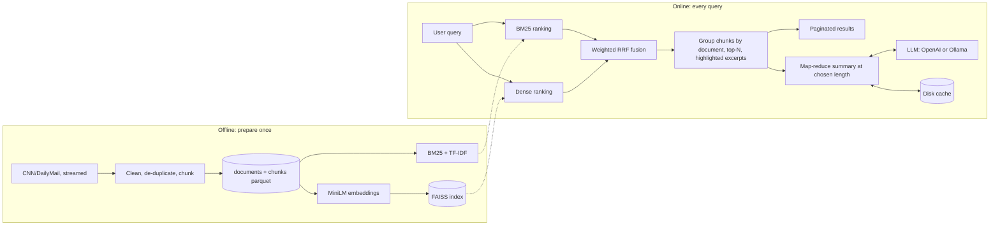
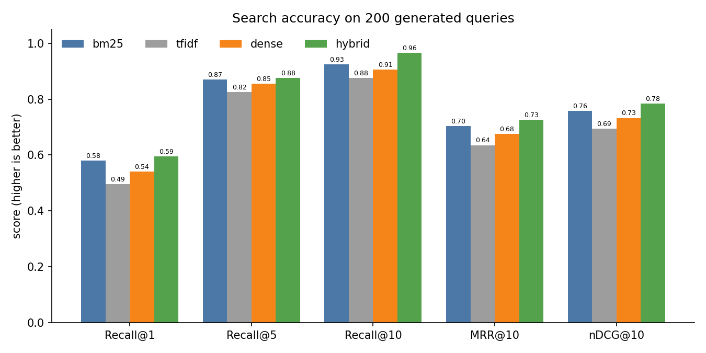

# Document Search and Summarization Using Large Language Models

**Project report.** Every number below was produced by the code in this repository (raw outputs are in
`reports/`). Where something was not measured or was done on a smaller sample than planned, the text says so.

## 1. Introduction and objective

Readers of a large news archive want two things: to find the few articles that matter for a question, and
to get the gist without reading all of them. This project builds a system that

1. searches a sizeable text corpus for a user query and returns the top-N documents with the best-matching
   excerpts, using a **hybrid** of traditional information retrieval (BM25 / TF-IDF) and LLM embeddings;
2. **summarizes** the retrieved documents with an LLM at a length the user chooses (about 50, 120 or 250
   words, or any word count);
3. **evaluates** both parts (search accuracy, summary quality, speed);
4. offers a small web interface with auto-suggestion, pagination and an adjustable summary length.

Design constraints: it must run on an ordinary laptop (CPU only, limited disk), keep all data and indexes in
the project folder, and make the LLM pluggable: OpenAI (`gpt-4o-mini`, key read from `.env`) or a local
Ollama model (`llama3.2:3b`, free and offline). All results here were produced with the local model.

## 2. Dataset choice and justification

**Corpus:** Hugging Face `abisee/cnn_dailymail`, configuration `3.0.0`.

- It is a large real-world news corpus (about 300,000 articles in total), so retrieval is a non-trivial task.
- Every article comes with human-written bullet "highlights", which serve as **reference summaries**. This lets
  us measure summary quality with ROUGE without writing any gold data ourselves.
- It is freely available and can be **streamed**, so only the part that is used is downloaded.

**Subset used (laptop-sized, set in `config/config.yaml`):** the first 20,000 articles of the train split that
survive cleaning form the searchable corpus; 1,000 articles of the test split form a separate held-out pool,
de-duplicated against the corpus. The train split is read in file order, so the slice is dominated by
CNN-sourced articles (about 2007 to 2015). Scaling up is one config value (`corpus.train_docs`).

## 3. Data pre-processing and justification

Each step is logged with counts (`reports/data_stats.json`). 21,490 rows were read to obtain 20,000 kept
documents.

| Step | Documents affected | Why (reason) |
|---|---|---|
| Strip datelines such as `LONDON, England (CNN) --`, partner datelines `(Mashable) --`, `(Reuters) --` | 21,035 (20,009 + 20 + 1,006) | Appear in nearly every article but say nothing about its content; left in, every article would match queries like "CNN" or "New York". |
| Remove "E-mail to a friend" | 1,273 | Web-page navigation text, not news. |
| Remove URLs / stray HTML / HTML entities | 273 / 1 / 16 | Not readable content; pollutes keyword matching and LLM input. |
| Unicode NFKC + whitespace normalisation | 225 / 6,405 | The same character must be the same token, so search is not split by typography. |
| Drop articles under 50 words | 8 | Too little text to search or summarize. |
| Drop exact duplicates (hash of normalised text) | 1,360 | Duplicates would fill the top-N with the same story. |
| Drop near-duplicates (same first 40 normalised words) | 122 | Re-published versions of one story, same effect. |

Words in the 21,490 rows read: 12,843,994 before cleaning; the 20,000 kept documents contain 11,864,717 words
after cleaning. Cleaning therefore removed little content, mostly boilerplate and duplicates. The Daily Mail
byline and "PUBLISHED/UPDATED" patterns are implemented but matched nothing in this slice.

Two views of each text are stored: the original casing and punctuation (`text`, which the LLM reads) and a
lowercased, tokenised, stopword-free version (`bm25_text`, used only by BM25 and TF-IDF).

**Chunking.** Articles are split into sentence-aware chunks of about 200 words with about 40 words of overlap
(a sentence is never cut in half), giving **77,338 chunks** (3.87 per article, mean 192 words). The title is the
article's first sentence. Corpus statistics: mean 593 and median 528 words per article (min 55, max 1,824);
reference summaries average 44.5 words.

## 4. Methodology

### 4.1 Indexing (`src/indexing.py`)

| Index | Method | Build time | Size on disk |
|---|---|---|---|
| BM25 | `rank_bm25` BM25Okapi (k1 = 1.5, b = 0.75) on stopword-free tokens | 15 s | 76.5 MB |
| TF-IDF | scikit-learn, unigrams, sublinear tf, min_df = 2 (lexical baseline) | 12 s | 55.3 MB |
| Embeddings | `all-MiniLM-L6-v2` (384-dim), L2-normalised, max 256 tokens | 77.7 min (CPU) | 118.8 MB |
| FAISS | `IndexFlatIP` (exact inner product = cosine) | 0.2 s | 118.8 MB |
| **Total** | | | **369.4 MB** |

All indexes are persisted in `indexes/` and loaded (1.5 s) instead of rebuilt. Embedding is the only expensive
step; it is done in blocks of 5,000 chunks and checkpointed so an interrupted run resumes.

### 4.2 Search (`src/search.py`)

- **BM25 and TF-IDF** rank chunks with the same preprocessing as the corpus (lowercase, tokenise, drop
  stopwords; an all-stopword query keeps its plain tokens).
- **Dense:** the raw query is embedded with the same model; FAISS returns the nearest chunks.
- **Hybrid = weighted Reciprocal Rank Fusion** of the BM25 and dense rankings,
  `score(chunk) = sum_i w_i / (60 + rank_i(chunk))`, with weights 0.5 / 0.5 from the config. RRF uses ranks
  rather than raw scores, so BM25's unbounded scores and cosine similarities need no calibration. Each ranker
  contributes its top 100 chunks.
- **Document level:** chunk hits are grouped by article; the article's score is its best chunk's score and it is
  returned once. `search(query, top_n, method, page, page_size)` returns pages of results (rank, doc id, title,
  score, method, excerpts).
- **Excerpt extraction:** each result carries up to two matching chunks, each trimmed to the 60-word window
  containing the most query terms, with matched words highlighted (whole-word, case-insensitive, plural-tolerant).

### 4.3 Summarization (`src/llm.py`, `src/summarize.py`)

- **Provider abstraction.** One interface, two clients selected by `llm.provider` (or `LLM_PROVIDER` in
  `.env`). Timeouts and retries (3 attempts, exponential backoff 2 s, 4 s) apply to transient failures; a
  missing API key, an unreachable Ollama server or a missing model fail immediately with a message saying
  how to fix it. Temperature is 0.2.
- **Prompt design.** A system prompt tells the model to use only the supplied text, add no facts, names, numbers
  or opinions, and write one plain paragraph without headings or preamble. The user prompt states the word
  target and an allowed range (target +/- 25%). For several documents, a second prompt lists the per-document
  summaries and asks for one coherent summary that merges overlaps and mentions clearly different stories,
  again using only the information given.
- **Length control.** Small models miss word targets, so if the result is outside the range the request is
  repeated once with a note on how it missed; the closest attempt is kept and, if still too long, trimmed at a
  sentence boundary. The achieved word count is always reported.
- **Map-reduce.** Several documents are summarized one by one (about 100 words each, the "map" step), then the
  summaries are combined into one summary of the requested length (the "reduce" step). An article too long for
  the context window is split into sentence-aligned segments that are mapped and reduced the same way; if
  partial summaries still do not fit, they are grouped and reduced again. Token use is estimated as 1.4
  tokens per word, keeping each call under 2,800 input tokens inside Ollama's 4,096-token window.
- **Caching.** Summaries are cached on disk, keyed by document ids, word target, provider, model, temperature and
  prompt version. Repeating a request makes no LLM call; per-document map summaries are reused across lengths.

### 4.4 Interface and optional fine-tuning

- **Streamlit app** (`app/streamlit_app.py`): search box with auto-suggestion (a prefix index over about 38,000
  frequent corpus phrases and short titles, ranked by frequency, with recent queries first), method / top-N /
  results-per-page controls, summary length (short / medium / long or a custom 20-500 word slider), paginated
  result cards with highlighted excerpts and an expandable full article, and a "Summarize results" button that
  shows the summary and the time taken. Indexes and models load once (`st.cache_resource`).
- **Embedding fine-tuning** (`scripts/finetune_embeddings.py`, off by default): adapts MiniLM with
  `MultipleNegativesRankingLoss` on 300 (LLM query, passage) pairs from training articles only, one epoch.
  Results in section 6.5.

## 5. Evaluation procedure

**Test set.** 200 articles drawn at random (seed 42) from the indexed corpus. `llama3.2:3b` read the first 350
words of each and wrote one 3-8 word search query, instructed to paraphrase rather than copy; a query sharing
5 or more consecutive words with the article is regenerated once. Examples: "A380 maiden flight luxury
features", "Argentine president defends grain export tax hike". The article the query came from is the single
relevant document.

**Search metrics** (cut-off 10, one relevant document per query, so the ideal DCG is 1):

- **Recall@k** (= hit rate): share of queries whose target is in the top k (k = 1, 5, 10).
- **MRR@10:** mean of 1/rank of the target (0 if it is not in the top 10).
- **nDCG@10:** mean of 1/log2(rank + 1) (0 if outside the top 10).
- **Precision@5:** hits in the top 5 divided by 5; with one relevant document it cannot exceed 0.2.

**Summary quality.** (a) ROUGE-1, ROUGE-2 and ROUGE-L F1 (stemmed, `rouge-score`) of each LLM summary against
the article's human highlights, for each length, compared with a **lead-3** baseline (first three sentences).
(b) A human-evaluation sheet: sampled (query, retrieved documents, summary) rows with full source text, to be
scored 1-5 for coherence, coverage, faithfulness and conciseness.

**Efficiency.** Mean and 95th-percentile latency of index loading, each search method (200 queries, warm) and
summarization (real generation times recorded during evaluation).

## 6. Results

### 6.1 Search accuracy (200 queries)

| Method | Recall@1 | Recall@5 | Recall@10 | MRR@10 | nDCG@10 | Precision@5 |
|---|---|---|---|---|---|---|
| BM25 | 0.580 | 0.870 | 0.925 | 0.704 | 0.758 | 0.174 |
| TF-IDF | 0.495 | 0.825 | 0.875 | 0.635 | 0.695 | 0.165 |
| Dense (MiniLM) | 0.540 | 0.855 | 0.905 | 0.676 | 0.733 | 0.171 |
| **Hybrid (RRF)** | **0.595** | **0.875** | **0.965** | **0.725** | **0.784** | **0.175** |

Hybrid is best on every metric; its clearest gain is Recall@10 (+4 points over BM25, +6 over dense). BM25 is a
strong baseline because the queries reuse article vocabulary; TF-IDF is weakest. With 200 queries the
standard error of a difference between two systems is a few points, so small gaps (for example BM25 vs
hybrid at Recall@1) are within noise.

### 6.2 Summary quality: ROUGE against the human highlights

40 test articles were summarized at each length (`evaluation.summary_eval_docs`; summarizing all 200 at three
lengths would take about 6 hours on this CPU).

| System | Docs | ROUGE-1 | ROUGE-2 | ROUGE-L | Mean words |
|---|---|---|---|---|---|
| Lead-3 (same 40 docs) | 40 | 0.306 | 0.101 | 0.202 | 56.5 |
| Lead-3 (all 200 test docs) | 200 | 0.346 | 0.140 | 0.224 | 66.8 |
| LLM short (~50 words) | 40 | **0.371** | **0.132** | **0.252** | 49.3 |
| LLM medium (~120 words) | 40 | 0.297 | 0.107 | 0.190 | 123.5 |
| LLM long (~250 words) | 40 | 0.221 | 0.087 | 0.148 | 225.9 |

- The short LLM summary beats lead-3 on the same 40 articles (ROUGE-1 0.371 vs 0.306). Lead-3 scores higher on
  all 200 articles than on this subset, so the subset is a harder sample; the same-documents comparison is the
  fair one, and with n = 40 it is suggestive rather than conclusive.
- Longer summaries score lower because F1 penalises length when the reference is about 45 words (extra words
  reduce precision). ROUGE therefore says little about whether a longer summary is better for a reader.
- Word targets are met on average (49 / 124 / 226 words for targets of 50 / 120 / 250); the observed ranges
  are 42-55, 105-137 and 180-284 words.
- ROUGE rewards overlap with a human-written highlight, not factual accuracy.

### 6.3 Human evaluation

`reports/human_eval_sheet.csv` contains **15 rows** (the brief asked for 30; the other 15 were left out for
time and can be added by setting `human_eval_samples: 30` and re-running, since earlier results are cached).
Each row has the query, the top-3 hybrid results, their full text, the medium combined summary, and empty
columns for 1-5 ratings of coherence, coverage, faithfulness and conciseness.

**These ratings have not been filled in, so there are no human-evaluation averages to report.** Once the
sheet is scored, `python scripts/score_human_eval.py` prints the averages and writes
`reports/human_eval_scores.json`. Summary faithfulness (no made-up facts) is therefore currently unmeasured;
the prompts instruct the model to use only the given text, and a few summaries were read informally, but that
is not an evaluation.

### 6.4 Efficiency (CPU laptop)

| Component | n | Mean | p95 |
|---|---|---|---|
| Load indexes (BM25 + TF-IDF + FAISS) | 5 | 1.5 s | 1.5 s |
| Load embedding model | 1 | 0.4 s | n/a |
| Search: BM25 (top 10) | 200 | 171 ms | 237 ms |
| Search: TF-IDF | 200 | 18 ms | 19 ms |
| Search: dense | 200 | 20 ms | 22 ms |
| Search: hybrid | 200 | 191 ms | 261 ms |
| Summarize 1 document, short | 40 | 36 s | 58 s |
| Summarize 1 document, medium | 40 | 41 s | 64 s |
| Summarize 1 document, long | 40 | 52 s | 76 s |
| Summarize top-3 documents, medium (map-reduce) | 15 | 152 s | 213 s |

Search is interactive. BM25 (and so hybrid) is the slowest retriever because `rank_bm25` scores every chunk in
Python on each query, while dense search over 77,338 vectors takes about 20 ms. Summarization dominates the
cost: a local 3B model on this CPU needs well over a minute for a combined summary. The disk cache makes a
repeated request instant, and the OpenAI provider would shorten summaries to seconds (not measured here).

### 6.5 Fine-tuning the embedding model (optional improvement)

The base model was adapted on 300 (query, passage) pairs from articles **outside** the test set (checked by an
assertion and a unit test); training took 41 s, writing the pairs about 55 minutes, and re-embedding the corpus
about 36 minutes. Same 200 test queries (`reports/embedding_comparison.csv`):

| Method | Metric | Base | Fine-tuned | Change |
|---|---|---|---|---|
| Dense | Recall@1 | 0.540 | 0.575 | +0.035 |
| Dense | Recall@10 | 0.905 | 0.920 | +0.015 |
| Dense | MRR@10 | 0.676 | 0.705 | +0.028 |
| Dense | nDCG@10 | 0.733 | 0.758 | +0.025 |
| Hybrid | Recall@1 | 0.595 | 0.645 | +0.050 |
| Hybrid | Recall@10 | 0.965 | 0.970 | +0.005 |
| Hybrid | MRR@10 | 0.725 | 0.755 | +0.030 |
| Hybrid | nDCG@10 | 0.784 | 0.807 | +0.024 |
| BM25 (control) | all metrics | unchanged | unchanged | 0.000 |

Every dense and hybrid metric moved up while the BM25 control is identical, so the change comes from the
embedding model alone. The direction is consistent, but with 200 queries individual changes (especially
Recall@10) are within noise, and the training queries came from the same LLM and prompt style as the test
queries, which probably helps. The fine-tuned model is therefore reported as a promising small gain, not a
proven improvement, and is off by default (`finetune.enabled: false`).

### 6.6 The interface

Screenshots (`reports/figures/`): `app_1_autosuggest.jpg` (typing "tropical st" offers "tropical storm",
"tropical storm warning"...), `app_2_pagination_page1.jpg` and `app_3_pagination_page2.jpg` (3 results per
page, "Page 1 of 2" then "Page 2 of 2" with Next disabled), `app_4_custom_length_summary.jpg` (custom 60-word
target on 2 articles: 71 words in 87 s). The Short / Medium / Long radio buttons use the same code path as the
custom slider and were exercised through the command line, but were not clicked through in the browser.

## 7. Scalability and efficiency

What was measured here: 77,338 chunks, 369 MB of indexes, 1.5 s to load, about 20 ms dense search and 190 ms
hybrid search. The following is how the design scales; figures for larger corpora are extrapolations, not
measurements.

- **Dense index.** `index.faiss.type` switches from exact `flat` search to `ivf` (IndexIVFFlat: vectors are
  clustered and only `nprobe` clusters are searched) or `hnsw` (graph index). Both build and query correctly
  in the unit tests; their recall and speed at this corpus size were not measured. Memory for flat vectors is
  4 x 384 bytes per chunk (119 MB here, about 1.5 GB for a million chunks).
- **Embedding throughput.** Embedding is a one-off, batched, resumable job (about 17 chunks per second on the
  first, busy run and about 36 per second when the laptop was idle). Extrapolated linearly, a million chunks
  would need many hours on CPU, which a GPU, a smaller model or quantised/ONNX inference would cut sharply.
- **Persisted indexes.** Indexes are built once, saved and loaded in seconds; the app loads them once per process.
- **Lexical search.** `rank_bm25` scores every chunk in Python (171 ms here) and will become the bottleneck
  first; at larger scale it should be replaced by an inverted-index engine (for example a Lucene-based or
  `bm25s` implementation), which keeps BM25 in milliseconds. Hybrid search latency is currently dominated by it.
- **Caching.** LLM outputs (queries, per-document summaries, combined summaries) are cached on disk, so repeated
  or overlapping requests cost nothing.
- **LLM cost.** Summarizing only the retrieved top results (map-reduce, capped at 5 in the app) bounds cost per
  query. A smaller local model keeps the system free and offline; the OpenAI provider trades money for speed.
- **Hosting.** `config/config.cloud.yaml` builds a 2,000-article demo corpus on first start, so the app can run on a
  small host without shipping the data (see the README). Run locally from scratch with that config it built in about 9 minutes (7,791 chunks, 54 MB) and answered queries correctly; it has not been run on a cloud host.

## 8. Challenges and how they were solved

| Challenge | What happened | Solution |
|---|---|---|
| Messy boilerplate | A first cleaning pass left datelines like "NEW YORK (CNN) --" and "(Mashable) --" in 2,279 articles, which would have polluted titles and keyword matching. | Audited the output, widened the patterns step by step (including datelines after a teaser, hyphenated places and partner outlets) until none remained, with per-step counts and unit tests. |
| Slow CPU embedding | Embedding 77,338 chunks took 78 minutes on this (emulated x64) Python. | Block-wise embedding with checkpoints so a sleep or crash resumes; indexes are persisted and reused. |
| Slow local LLM | 24 s per generated query and 36-52 s per summary meant the full evaluation would take many hours. | Everything is cached and resumable; ROUGE ran on 40 articles and the human sheet has 15 rows (both configurable); the shortfalls are stated in this report. |
| Models miss word targets | A 3B model often returned 20-40% off the requested length. | One corrective retry, then sentence-level trimming; word counts are reported. |
| LLM-written queries copying text | Queries sometimes repeated whole phrases of the article, which would make retrieval trivially easy. | A copy detector rejects queries sharing 5+ consecutive words with the article and retries once. |
| Ollama not running / key missing | The first summarization attempt had no server. | Clear, actionable error messages; documented `ollama serve` and `ollama pull` steps. |
| No native autocomplete in Streamlit | Streamlit text boxes only update on Enter. | `streamlit-searchbox` component driven by a prefix index of frequent phrases and titles. |
| Dollar amounts rendered as maths | "$41.1 million ... $5 million" in articles was typeset as LaTeX. | Escape Markdown/LaTeX characters before display. |
| Running on a machine with no data | A hosted app has none of the local indexes. | A small-corpus config plus a first-start bootstrap that builds the demo corpus and indexes. |

## 9. Limitations and future work

**Limitations**

- Evaluation uses one relevant document per query, so other articles on the same story count as misses and
  accuracy is understated; queries were written by an LLM that had read the article, which may favour keyword
  matching. One random sample of 200 queries gives only a few points of resolution.
- ROUGE and latency for summaries use 40 documents, and the human sheet has 15 rows that are **not yet scored**;
  summary faithfulness is therefore unmeasured. ROUGE does not measure faithfulness.
- One corpus (English news, roughly 2007 to 2015, mostly CNN in the slice used).
- Some CNN Student News items have a date as their "title" (e.g. "October 29, 2009 .") because the title is the
  first sentence.
- Summaries take 36-152 s on a CPU model; the OpenAI provider was implemented and unit-tested with a fake key but
  never called with a real one, and the hosted deployment (Streamlit Community Cloud) was not tested on the
  cloud itself.
- The fine-tuning gain is small and not shown to be statistically significant.

**Future work:** score the human sheet and extend it to 30+ rows; add an automatic faithfulness check (for
example an LLM or NLI judge over summary sentences); evaluate with several relevant documents per query and
bootstrap confidence intervals; swap `rank_bm25` for an inverted-index BM25 and measure IVF/HNSW recall and
latency; fine-tune with more pairs and hard negatives; add query rewriting, a cross-encoder re-ranker and
streaming summaries to the app.

## 10. Reproducibility and quality

- Fixed random seeds (sampling, test set, human sheet) and all settings in `config/config.yaml`; secrets only in
  `.env`; every dependency pinned in `requirements.txt` (Python 3.11).
- 67 automated tests (`python -m pytest`, about 15 s, no network or LLM needed): cleaning, chunking, BM25 /
  TF-IDF / dense / hybrid ranking, RRF, pagination, length control with a mocked LLM, ROUGE and metrics, FAISS
  variants, suggestions and configuration. `ruff` and `black` pass on the whole repository.
- Reproduce: `prepare_data.py` -> `build_index.py` -> `query.py` -> `run_eval.py` -> `streamlit run
  app/streamlit_app.py` (details in the README).

